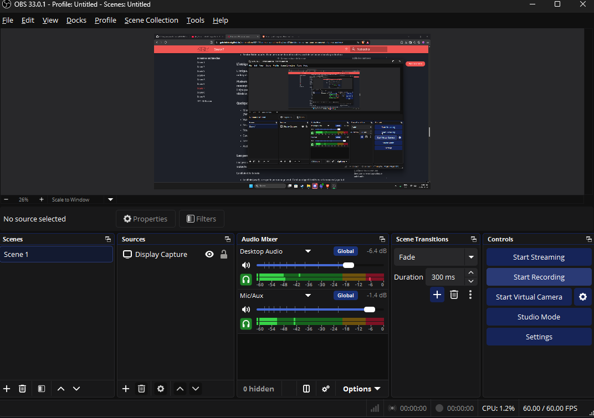

# analyse-domaine Felipe Pereira

## Découverte de soi

- Mes forces : Je suis bon a faire des mondes fictif avec une abondance de personnages et a crée des visions des personnages et leurs environnements.
    - Exemple : Ma passion pour les dessins et l'envie de crée un monde intéressant avec beaucoup de lore.
- Mes faiblesses ou points à améliorer : J'ai de la difficulté a avoir une hisotire fixe puisque je change toujours une partie de mon histoire lorsque je me remet en action. 
    - Exemple : Lorsque j'écris une histoire, j'ai tendance a scrappé mes idées qui pourrait être plus développé en faveur de nouvelles idées.
- Seul(e) ou en équipe : Je préfère travailler seul dans mes projets en général.
    - Pourquoi et exemple : Puisque le manque de concensus entre équipe m'offre la liberté créatif pour faire ce que je veux dans mes travaux. Cela m'aide a m'attacher plus a mes projets d'un niveau personel. Par exmemple, une idée de film. Puisuqe je suis seul, c'est seulement moi qui fait les concepts qui veux dire que je peux faire le film a ma vision.
- Plutôt technique ou créatif : Je me sens beaucoup plus a l'aise avec les affaire qui nécessite la créativité humaine. la raison pouquoi je préfère la créativité est car je dessine depuis que j'ai 5 ans. Le code et la porgrammation est un affiare plus récent que j'ai sueulement commencer a experimenter il y a 2 ans. 

## Exploration des domaines

| Domaine | Intérêt | Pourquoi |
|---|---|---|
| Graphisme | moyen | La création de logo ma toujours un peu interessé. |
| Vidéo et animation 2D | fort | j'adore regarder des animation et j'en ai déja fait avant. |
| 3D | fort | Je trouve le 3D incroyable et facilite l'animation. |
| Web | moyen | J'aime le code mais j'ai de la difficulté |
| Jeux vidéo | fort | j'en joue depuis que je suis bébé puis c'est mon rêve de faire un jeu |
| Développement logiciel | faible | c'est pas quelque chose que je planifiait a faire. |
| Installations et expériences immersives | moyen | la réalité est une expérience immersive qui ma intrigué puis j'aimerais en faire. |

## Mes 2 domaines préférés

### Domaine 1 : Vidéo

- Expérience : J'ai déja été parti dans la création de 2 films au secondaire. J'ai fait le role d'acteur et le role de éditeur
- Logiciels et outils : Je sais comment utliser Capcut et Final Cut Pro et j'aimerais apprendre comment utliser DaVinci Resolve.
- Pourquoi il m'intéresse : La raison pouquoi le film m'intérsse est car j'adore les films de comédie comme Super Bad et Ted. Youtube ma aussi introduit beaucoup de skits et de parodies comme Smosh.
- Travailler dans ce domaine : Oui, je me vois travailler dans se domaine un jour pare que toutes les étapes de la création d'un film me plait et je sais plus au moins comment bien faire chaque étape.

### Domaine 2 : Animation 2D

- Expérience : j'ai déja fait des petites animations sur ma tablette pour le fun. J'ai aussi fait une animation de 15 minutes l'année passé pour mes amis.
- Logiciels et outils : J'ai utliser Capcut, FlipaClip et ProCreate pour faire des animations frame par frame et animation avec des pngs.
- Pourquoi il m'intéresse : La raison pourquoi l'animation m'interesse est car j'ai toujours voulu faire un anime/cartoon pour raconter mes histoires que j'invente.
- Travailler dans ce domaine : Dans ce domaine, je me vois travailler comme créateur de storyboards ou faire des commissions.

## Les caractéristiques de mon domaine préféré

- Types d'entreprises : Studios de création audiovisuel et instituts culturels
- Exemple d'entreprise : Studios Machiavel et Centre des Sciences Montréal

(source de l'image : ...)

- Types de produits et de services : Le contenu audio visuel et les jeux vidéos (histoires)
- Étapes de production : Mon emploi est dans la partie de préproduction
- Type d'emploi visé : J'aimerais être un artiste de storyboard.
- Étapes pour obtenir cet emploi : j'ai besoin d'un Baccalauréat en art et science de l'animation.

## Conclusion

- Mon profil en une phrase : Je suis une personne créatif qui désire innovés l'animation en appliquant des nouvelles techniques.
- Ce qui m'a surpris : J'ai appris que le world building est une plus grande partie de moi et mon côté artistique que je pensais.
- Ma force principale et la faiblesse à travailler : ma force principale est la conception des idées pour des animation ou films. Une faiblesse que je doit améliorer est mon esprit d'équipe puisque je fait mes affaires seul en général.
- Mon action d'ici la fin de la session : Faire une vidéo Youtube de bonne qualité

## Ma capsule

